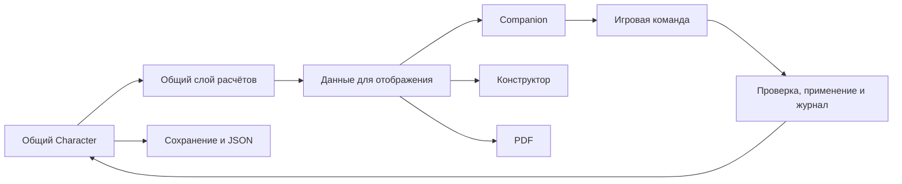

# Анализ листов персонажа: Mythras Tools и Mythras Companion

**Дата:** 12 ноября 2026 года.  
**Оригинал:** `Tsinwntas/mythras-tools`, `master`, `80240dbbb5899744136e5f31f4451d9c91416034`.  
**Форк:** `JoskiyChel/mythras-tools`, локальная ветка `feat/antiquity-ui`, `7051611effeca2b1f28eabfc6e17124815a573a3`.

## 1. Вывод

**Companion лучше организован для игры, но пока не является полной функциональной заменой исходного листа.** Он выигрывает в работе с HP, ресурсами, эффектами, просмотром сложностей и предпросмотром прокачки. Исходный лист предоставляет больше возможностей непосредственного редактирования и показывает некоторые данные, которых нет в Companion.

Главные результаты:

1. Общая модель `Character`, конструктор, библиотека, JSON, PDF и offline-режим сохранены. Это общая основа, а не новые возможности Companion.
2. Переход в конструктор компенсирует часть отсутствующих редакторов, но прерывает игровой сценарий. Это ухудшение доступности действия на листе, а не обязательно потеря самого действия во всём приложении.
3. Есть отдельные данные, которые новый лист не показывает: `magic.abilities`, `devotionPool`, `devotionPoolCurrent`, подробности выбранной черты боевого стиля, часть биографических и экономических сведений. Их сохранность в JSON не заменяет доступность в интерфейсе.
4. Автоматизация частичная: длительность эффекта хранится текстом; усталость влияет на ряд атрибутов, но не формирует контекст проверки навыка; экипировка не является полноценным переключателем нагрузки и эффектов.
5. Следующий полезный этап — закрыть пробелы и обеспечить объяснимость расчётов и отмену действий. Полноценный виртуальный игровой стол, облачная синхронизация и автоматическое разрешение боя сейчас имеют меньший приоритет.

**Рекомендация:** развивать Companion как лист для живой игры с общей моделью персонажа и контролируемой автоматизацией. Сначала — корректность и функциональное покрытие, затем — дополнительные игровые помощники.

## 2. Что и как сравнивалось

На дату проверки удалённый `HEAD` оригинального проекта действительно указывает на `80240db`. Реализация `responsive-character-viewer.component.ts`, сохранившаяся в форке, побайтово совпадает с этой версией оригинала. Сравнение не основано только на воспоминаниях о старом интерфейсе.

В оригинале есть два представления:

- **Responsive Viewer** — интерактивный экран с разделами Play, Overview, Attributes, Skills, Combat, Weapons & Armor, Notes, Magic, Customization. Это основной объект функционального сравнения.
- **PDF / Print View** — отдельное печатное представление, также связанное с персонажем. Оно сохранено в форке и не заменено новым силуэтом тела.

В форке `/view/responsive` теперь перенаправляется на `/view/companion`. Старый компонент остаётся в исходниках, но обычный пользовательский маршрут его больше не открывает.

Методы анализа:

- сопоставлены шаблоны, обработчики действий, модель, сервисы расчётов и сохранения;
- выполнены новые изолированные проверки расчётов на небольших синтетических данных;
- через обычный импорт в Chromium проверена видимость специальных полей и магии без заклинаний; данные взяты в отдельном браузерном контексте, пользовательское хранилище не менялось;
- учтены предыдущие проверки этого коммита: 60 тестов совместимости и Companion, оба предоставленных JSON, цикл редактирования/экспорта/импорта, offline и PDF. Эти проверки подтверждают конкретные сценарии, но не правильность всех механик;
- изучены публичные материалы и исходники Roll20, Foundry D&D5e, DiceCloud и W3C APG. Это анализ подходов; аккаунты и живые кампании в сторонних сервисах не тестировались.

В рамках этого задания игровые функции не исправлялись: результат — отчёт и рекомендации. Полного текста Mythras Core Rules среди доступных материалов нет, поэтому соответствие спорных формул первоисточнику отдельно не подтверждено.

## 3. Сравнение функциональности

### 3.1. Персонаж, навыки и проверки

| Возможность | Исходный Responsive Viewer | Наш Companion | Оценка |
|---|---|---|---|
| Общая модель и автосохранение | `Character`, `AppStorageService` | Те же модель и сервис | Сохранено; новая независимая база персонажей не нужна |
| Имя, игрок, вид, пол, возраст, культура, карьера | Поля в Overview редактируются на листе | Часть сведений показана в заголовке; редактор — в конструкторе | На новом листе меньше прямого редактирования |
| Рост, вес, Frame | Редактируются на листе | Редактируются на листе | Сохранено |
| Характеристики: исходное и текущее значение | Отдельные текущие переопределения | Итоговое значение с эффектами, прокачкой и уже существующими overrides | Расчёт расширен, но отдельного редактора текущего STR/CON и т. п. нет |
| Атрибуты и ручная коррекция | Итоги можно непосредственно менять; есть damage override | Итоги вычисляются, есть модификаторы эффектов; отдельного редактора постоянных overrides нет | Временный эффект не равноценен постоянной ручной поправке |
| Обычные навыки | База, итог, бонус, прямое редактирование | Группы, поиск, итог, окно сложностей, прокачка | Улучшена игра; состав результата раскрыт слабее |
| Профессиональные и пользовательские навыки | Добавление, редактирование, встроенная Customization | Изученные навыки видны; создание/изучение — через конструктор | Данные сохраняются, действие вынесено с листа |
| Сложности навыков | На самом листе нет аналогичного единого окна с вычисленными порогами для каждого навыка | Единое окно Very Easy → Herculean, включая магические навыки | Новая полезная функция |
| Бросок d100 и его результат | Отдельного встроенного механизма броска на листе нет | Окно показывает пороги, но не бросает кости и не разрешает проверку | Перспективная возможность, пока не реализована |
| Постоянная прокачка | Правка итогов/бонусов без общего подтверждаемого предпросмотра | Предпросмотр, прямые и зависимые изменения, применение/отмена | Существенное улучшение, но не полноценный учёт опыта |
| Прокачка боевого стиля | Итог стиля можно исправить прямо на листе | Стиль показан фишкой; в списке прокачки навыков отсутствует | Функциональный пробел |
| Языки и родной язык | Отдельные поля и строки языков | Навыки могут попасть в общий список, отдельного языкового блока нет | Часть контекста и управления потеряна |
| Страсти | Текст, объект страсти и правило процента редактируются | Преимущественно текстовое отображение, без общего окна проверки | Нужна отдельная модель проверки страсти, а не принудительное превращение её в `Skill` |

### 3.2. Игровые действия, здоровье и состояния

| Возможность | Исходный Responsive Viewer | Наш Companion | Оценка |
|---|---|---|---|
| AP, MP и Luck: текущие значения | Прямые поля; обычно пустые до ввода | Счётчики ±, максимум, ограничения диапазона | Удобнее в игре, но полезен также прямой ввод |
| HP семи локаций | Таблица максимумов и текущих значений | Силуэт с HP/AP, русскими подписями и d20 | Улучшение наглядности |
| Первоначальные/отсутствующие HP | Текущее значение остаётся пустым | Полное здоровье для нового/неинициализированного персонажа; отображаемый fallback для частичного сохранения | Удобнее, важно сохранять явные 0 и отрицательные значения |
| Нанесение урона и лечение | Ручной ввод текущих HP | Изменение выбранной локации на 1–999 HP, лечение до максимума | Улучшение; обнаружен пограничный дефект, см. §4 |
| Учёт брони при ударе | AP видны, автоматического применения урона с бронёй нет | AP видны, кнопка `− HP` меняет HP напрямую | Это редактор потери HP, а не полное разрешение попадания |
| Постоянная травма | Отдельного аналогичного структурированного редактора нет | Отдельная запись, сохраняемая после лечения | Новая полезная функция; её числовые последствия не автоматизированы |
| Усталость | Выбор уровня, без нового слоя пересчёта | Таблица уровней, поправки Initiative/AP/Movement | Улучшение; контекст проверки навыка ещё не объединён с усталостью |
| Временные эффекты | Нет соответствующего общего редактора | Описание, длительность, модификаторы характеристик/навыков/атрибутов | Полезное расширение |
| Жизненный цикл эффекта | Нет общей системы | Создать и удалить; длительность — строка, выключения и автоматического истечения нет | Частичная реализация |
| Дары | Не аналог нынешнего общего редактора | Сохранённые legacy-дары видны, новые нарративные записи создаются как эффекты | Соответствует согласованному отказу от отдельной вкладки даров |
| Движение | Ходьба, бег, спринт, плавание, два прыжка; базовую скорость можно менять | Окно движения, поправки брони и усталости; плавание не показано | Смешанный результат; формулы требуют сверки |
| Связь с боевым помощником | Прямой переход к Combat Flow | Отдельного перехода из Companion нет | Помощник остался в приложении, но доступ к нему хуже |
| Отмена последнего игрового действия | Нет общей пошаговой отмены | Нет | Одна из наиболее полезных общих доработок |

### 3.3. Оружие, магия, сведения и сохранения

| Возможность | Исходный Responsive Viewer | Наш Companion | Оценка |
|---|---|---|---|
| Боевой стиль | Итог, доступное оружие, выбранная черта и её правила | Название и процент | Восстановить подробности, не смешивая стиль с экземплярами оружия |
| Оружие | Карточки, прямое редактирование значений, правила эффектов и черт; для дальнего есть DM/Force/Load/Range | Таблица, часть параметров и раскрываемые описания; без прямого редактора, без ряда прежних правил-ссылок | Новый лист уступает по полноте |
| Выбор оружия и брони | Часть изменений через Customization | Через конструктор; у оружия можно отметить equipped | Полноценного управления снаряжением на новом листе пока нет |
| Экипировано / находится в сумке | Нет законченного универсального действия с автоматическим пересчётом всех последствий | Флажок оружия сохраняется; не управляет общей цепочкой ENC/брони/эффектов | Флажок сам по себе не завершает игровую механику |
| ENC и ручной штраф брони | Показаны Equipment ENC, Armour ENC, Total ENC, Armor Penalty с overrides | Показан штраф брони и ENC предметов/локаций, общей сводки ENC и редактора override нет | Нужно вернуть операционные сведения |
| Магические дисциплины и описания | Общий список с поиском, раскрытием описаний | Независимые карточки дисциплин, кликабельные навыки, описания | Представление улучшено |
| Поиск заклинаний | Есть поиск по имени/традиции/тегам/описанию | Нет поиска | Регресс для больших списков |
| Несколько открытых описаний заклинаний | Независимые native `details` | Один `openedSpell` на весь лист | Ограничение при сравнении заклинаний, а не дефект CSS-высоты |
| Изученная дисциплина без заклинаний | Магический навык доступен в Skills | В общем списке навык виден, карточки дисциплины нет | Состояния «нет навыка» и «нет выученных заклинаний» смешаны |
| `magic.abilities` | Видно в Magic и Notes | Не показано | Подтверждённый пробел отображения |
| Devotion Pool и текущий Pool | Отдельные поля | Нет соответствующих контролов | Важный пробел для теизма; обычные MP не заменяют этот ресурс |
| Сотворение заклинания и расход ресурса | Нет связанного действия | Нет связанного действия | Полезная будущая автоматизация после уточнения модели стоимости |
| Биография, контакты, культы, религия, дополнительные сведения | Несколько разделов и редакторов на листе | Только `sessionNotes` и отдельные заметки о снаряжении | Данные не равны игровым заметкам; нужны просмотр/быстрое редактирование |
| Деньги и доход | Есть информация и поля доходов | На новом листе нет соответствующего блока | Не удалено из модели, но недоступно в рабочем листе |
| JSON и библиотечные копии | Есть | Сохранены общие механизмы | Наследованное преимущество, не новое достижение листа |
| PDF и offline/PWA | Есть в приложении | Сохранены | Нельзя считать утраченными из-за нового экранного оформления |
| Конфликт другой вкладки | Есть защита в общем storage | Та же защита | Это обнаружение конфликта, не совместное редактирование и не синхронизация устройств |
| История изменений | Резервный снимок и восстановление в библиотеке | Тот же механизм | Не равно undo каждого удара, покупки или потраченного MP |

Вывод из матрицы: **главная потеря — не JSON-совместимость, а полнота доступа к данным и действиям непосредственно во время игры.**

## 4. Подтверждённые проблемы и ограничения

### 4.1. Пограничные случаи расчётов

Ниже — результаты новых проверок фактического кода, а не предположения о будущих возможностях.

| ID | Условие и фактический результат | Почему важно | Приоритет |
|---|---|---|---|
| R1 | Максимум груди 9, текущее HP 12, урон 1 → результат **9**, а не 11 | `changeLocationHp` применяет верхнюю границу и к урону. Если максимум снизился из-за временного состояния, нажатие снимает больше заявленного | P0 |
| R2 | Два отдельных навыка с именем `Lore`: 30 и 40. Модификатор `skill / Lore / +5` меняет оба на 35 и 45 | Записи не удаляются, но выбрать целью только одну невозможно: эффекты адресуются именем, не идентичностью навыка | P0 |
| R3 | При ENC шлема 4 и отсутствующем override штраф равен 1. При `armorPenalty: ""` или `null` он становится 0; явный числовой 0 также даёт 0 | Пустое значение и осмысленный нулевой override не различаются | P1 |
| R4 | У оружия задано `damage: "1d10"` и прежнее `ranged: "1d8"`. Companion показывает **1d10 / 1d8**, тогда как исходный лист выбирал ручной override **1d10** | Приоритет ручного урона потерян: итог смешан с прежним значением и выглядит как несколько режимов | P1 |

R1 требует уточнить политику HP выше текущего максимума. Даже если такие значения должны нормализоваться, нормализация не должна скрываться внутри кнопки «нанести 1 урона».

R2 не означает, что любой эффект обязан действовать только на одну запись. Нужны два явных режима: конкретный навык и группа/семейство навыков. Сейчас интерфейс не позволяет выразить это различие.

Основания: `changeLocationHp`, `modifierTotal`, `skillTotal`, `armourPenalty` в [companion-sheet.ts](../src/app/services/companion-sheet.ts); `weaponDamage` в [компоненте Companion](../src/app/pages/companion-character-sheet/companion-character-sheet.component.ts) и `getWeaponDamage` в [исходном компоненте](../src/app/pages/responsive-character-viewer/responsive-character-viewer.component.ts). Смешанное отображение урона дополнительно воспроизведено в браузере.

### 4.2. Неполная согласованность игрового состояния

**R5. Усталость ещё не является частью контекста проверки.** `FATIGUE_RULES.skillGrade` выводится как информация; `skillTotal` не использует её, а окно сложностей просто показывает все множители от процента. Сохранять базовый процент неизменным правильно; недостающая часть — объяснение, какая сложность применима к текущему действию с учётом усталости и других условий. В синтетическом примере при `Dead` AP и Initiative становятся 0, `canAct` — false, но процент Athletics остаётся доступен. Возможность попытки действия и возможность посмотреть справочный процент нужно различать.

**R6. Предпросмотр прокачки пересчитывает не все зависимости.** Характеристики, навыки и некоторые атрибуты принимают `draftStats`, но `get move()` вызывает `movementSummary(this.character)` без них. Бонус к Athletics в `draftSkills` также не входит в этот вызов. Отображаемый максимум HP может учитывать предпросмотр, тогда как операция изменения HP использует сохранённый максимум. Нужна единая проекция состояния или временная блокировка игровых команд во время предпросмотра.

**R7. Не задана полная политика изменения максимумов ресурсов.** Текущие AP/MP/Luck визуально ограничиваются максимумом. Если значение не задано, показывается максимум. Это удобно для старта, но до автоматизации раундов и заклинаний нужно определить, что происходит при временном повышении/снижении максимума и восстановлении исходного состояния. Иначе интерфейс может создавать впечатление расхода или выдачи ресурса без отдельного действия.

**R8. Длительность эффекта пока не управляет его применением.** Эффект с текстом «0 rounds» продолжает давать числовой бонус. Это ожидаемое следствие строкового поля, а не доказательство работающего таймера. Редактирование существующей записи, приостановка, источник и правила сложения отсутствуют.

Основания: [компонент Companion](../src/app/pages/companion-character-sheet/companion-character-sheet.component.ts), особенно `move`, `currentResource`, `adjustSelectedHp`, `difficultyTarget`, и [сервис](../src/app/services/companion-sheet.ts).

### 4.3. Проверенная невидимость сохранённых сведений

В изолированный персонаж добавлены `magic.abilities`, `devotionPool: 7`, `devotionPoolCurrent: 3`; у него уже есть Folk Magic 40% и выбранная черта Barbarian Warrior.

Браузер подтвердил:

- Folk Magic **40%** виден среди навыков;
- при пустом списке заклинаний магических карточек **0**;
- текст `magic.abilities` не показан;
- поля Devotion Pool не показаны;
- выбранная черта `Do or Die` на новом листе не показана;
- способности и значения pool остаются в `Character`;
- ошибок JavaScript нет.

Это важное различие между **сохранностью данных**, **видимостью данных** и **возможностью ими пользоваться**. Успешный импорт сам по себе подтверждает только первую часть.

### 4.4. Что нельзя объявить проверенным правилом

- Формулы прыжков, в том числе `verticalJump` с `heightMetres * 2`, требуют проверки по Mythras Core Rules. Наследование формулы из старого листа не доказывает её правильность.
- Штраф брони в новом сервисе отличается от прежнего helper-подхода с половиной worn ENC. Текущие результаты кода известны; окончательный выбор требует первоисточника и учёта ручного override.
- Проверки выше 100%, критические успехи/провалы, встречные проверки и сочетание степеней сложности нельзя реализовать копированием правил другой системы.
- `60 passed` — результат существующих тестов, а не сертификат полноты механик. R1–R4 показывают дополнительные границы, которые этим набором не покрыты.

## 5. Подходы к интерактивным листам

Изученные продукты рассматриваются как примеры устройства листа, а не как кандидаты на замену Angular-приложения или источники правил Mythras.

| Подход | Сильная сторона | Цена и ограничения | Что подходит нашему форку |
|---|---|---|---|
| Редактируемый документ / цифровой бумажный лист | Можно быстро исправить почти любое поле; работает с домашними правилами | Игрок сам отслеживает зависимости и причины значений | Сохранить ручные поправки и PDF, обозначать overrides |
| Реактивный расчётный лист | Снятие предмета или эффекта пересчитывает все связанные значения | Нужны ясные зависимости, источники и порядок применения | Развить существующий расчётный слой; показывать происхождение результата |
| Лист как набор игровых действий | «Проверить», «сотворить», «потратить», «нанести урон» связывают расчёт с изменением состояния | Ошибка автоматизации влияет сразу на несколько данных; нужна отмена | Вводить небольшие подтверждаемые операции, начиная с ресурсов и HP |
| Лист внутри VTT | Контекст хода, Actor/Item/Effect, броски и общая сцена | Зависимость от платформы, ведущего, сетевой сессии и сложной модели | Заимствовать контекст действия и эффекты, не строить полный VTT |
| Настраиваемые повторяемые секции | Пользовательские навыки, оружие, способности, произвольные строки | Без устойчивых идентификаторов возникают ошибки выбора и миграции | Сохранить custom-данные, добавить адресные ID и общий редактор сущностей |
| Локальный offline-лист | Быстрый запуск, игра без сети, пользователь контролирует файл персонажа | Браузерное хранилище не обеспечивает резервирование и общую работу устройств | Сохранить PWA, добавить историю и понятные резервные копии раньше облака |

### Что подтверждают источники

**Roll20.** Официальный репозиторий описывает поля, кнопки бросков, повторяемые секции, roll templates и sheet workers. Полезный принцип — данные, вычисления и вывод проверки образуют связанный рабочий процесс. Конкретный лист Mythras в Roll20 здесь не оценивался. [E1]

**Foundry D&D5e.** README разделяет поддержку Actors, Items, бросков/правил и справочного содержимого. В `ActiveEffect5e` есть источник эффекта, подавление, длительность и окончание действия. Для нас важна структурированность эффекта и его связь с предметом/действием; сами правила D&D переносить нельзя. [E2, E3]

**DiceCloud.** README прямо формулирует принцип «знать, откуда взялось каждое число» и иллюстрирует пересчёт последствий снятия предмета. Это хорошо соответствует нашему требованию единой модели Character и автоматически связанных показателей. Материал относится к указанному репозиторию; текущий интерфейс сайта DiceCloud отдельно не проверялся. [E4]

**W3C APG.** Модальный диалог должен удерживать фокус, закрываться Escape и предсказуемо возвращать управление. В Companion это уже реализовано и проверено; аналогичный стандарт нужен для будущих редакторов и действий. Это основа интерактивности, а не дополнительная игровая механика. [E5]

## 6. Какие дополнительные функции полезны

Приоритеты: **P0** — достоверность и безопасность изменения данных; **P1** — функциональное покрытие и основные игровые действия; **P2** — удобство; **P3** — интеграции. Это предложение к обсуждению, а не утверждённый план реализации.

| Функция | Практическая польза | Условия и критерий готовности | Приоритет |
|---|---|---|---|
| Отмена действия и локальный журнал | Исправить ошибочный удар, расход MP или снятие эффекта | Запись хранит причину и старое/новое значение; отменяется вся операция, а не одно случайное поле; история переживает перезагрузку | P0, до автоматических команд |
| «Почему такое значение?» | Понять Initiative, HP, навык и штраф | Раскрывается база → ручная поправка → эффект → броня/усталость → итог; источник кликабелен | P0 |
| Полный профиль на листе | Не уходить в конструктор за контактами, культом, биографией и деньгами | Показ существующих полей без дублирования их в новой модели; компактные редакторы | P1 |
| Полная карточка боевого стиля | Использовать выбранную черту и понимать доступное оружие | Процент кликабелен; есть черта, описание и источник; доступна прокачка стиля | P1 |
| Редактор оружия и брони на листе | Быстро сменить снаряжение во время игры | Переиспользуются каталог и исходные типы; надето, в руках и переносится имеют разные последствия; показана общая нагрузка | P1 |
| Полный блок магии | Работать с теизмом, способностями и ещё не заполненной дисциплиной | Показаны pools, `magic.abilities`, изученная дисциплина без spells; возвращён поиск, можно сравнить несколько описаний | P1 |
| Помощник проверки d100 | Выбрать сложность, увидеть результат и применённые условия | Два режима: ввести физический бросок или бросить виртуально; степень успеха считается по проверенным правилам; расход Luck отдельный и отменяемый | P1 после сверки правил |
| Помощник повреждений | Разделить «потерю HP» и «урон до брони» | Ручной режим HP остаётся; отдельный режим учитывает локацию, AP и явно выбранные исключения; операция отменяется | P1 после R1 и правил |
| Активные эффекты со сроком | Не забывать закончить бафф, страх или состояние | У эффекта есть источник, enabled, единицы длительности и событие окончания; существуют нарративные записи без модификаторов | P1 |
| Контекст раунда | Быстро восстановить AP и учитывать события окончания эффектов | Явное действие «Новый раунд», показ того, что изменится, единый источник номера раунда с Combat Flow | P2 после журнала |
| Действие заклинания | Связать выбранное заклинание, проверку и расход нужного ресурса | Стоимость и вид ресурса заданы структурированно; не угадываются из prose/tags; Theism Pool не подменяется MP | P2 после полного блока магии |
| Восстановление и отдых | Упростить лечение и снятие усталости | Выбор длительности и допустимых последствий по Mythras; никакого универсального D&D-подобного «полностью восстановить всё» | P2 |
| Избранные действия и навыки | Ускорить частые проверки на длинном листе | Небольшой закреплённый список в существующей колонке навыков; не новая большая панель | P2 |
| Рабочие страсти | Проверять и применять страсти во время игры | Числовое значение отделено от текстового правила; поддержаны старые поля; изменение навыка от страсти объяснимо | P2 |
| Учёт развития | Помнить, что и почему было повышено между сессиями | Журнал приростов, причина, при необходимости расход опыта; свободная правка остаётся для домашних правил | P2 |
| Боеприпасы, заряды и расходники | Не терять стрелы, дозы и специальные ресурсы | Универсальные пользовательские счётчики с максимумом/единицей и undo; при выстреле расход только после явного действия | P2 |
| Мобильный режим игры | Быстро добраться до HP, навыка и AP без длинной прокрутки | Контекстный компактный доступ внутри существующей структуры; понятные подписи ± и работа без мыши | P2 |
| Напоминания о резервных копиях | Снизить риск потери долгой кампании | Понятен возраст последней копии; локальные снимки и безопасный импорт с предпросмотром различий | P2 |
| Синхронизация устройств и общий доступ ведущему | Продолжить игру на другом устройстве, передать персонажа | Разрешения, разрешение конфликтов и локальный режим; требуется отдельное проектирование | P3 |
| VTT-интеграция | Передавать броски или экземпляр персонажа в игровую платформу | Отдельный адаптер, без привязки базового Character к чужой схеме | P3 |

Если выбрать только пять направлений: **закрыть пробелы магии/боевых стилей, объяснять расчёты, отменять действия, управлять экипировкой, выполнять проверки навыков с явным контекстом**. Исправления R1–R4 идут перед ними как основа корректности.

## 7. Как встроить это без новой несовместимой модели

Нынешняя архитектура — подходящая основа. Переписывать приложение на React или создавать второе постоянное хранилище персонажей не требуется.

Целевая схема, а не описание уже готовых модулей:

Рекомендуемые правила реализации:

1. **Один сохраняемый Character.** Вычисляемое представление существует только для UI; оно не становится вторым несовместимым JSON.
2. **Единый расчётный контекст.** Все показатели получают одни и те же текущие характеристики, ручные overrides, предпросмотр, эффекты и состояния. Итог несёт список причин, а не только число.
3. **Разделить просмотр и изменение.** Просмотр HP не должен незаметно лечить или нормализовать персонажа. Игровая команда проверяет условия и меняет данные явно.
4. **Устойчивые идентификаторы.** Навык, предмет и эффект адресуются ID, а не именем. Старые записи читаются через совместимый адаптер; одинаковые имена не объединяются. Добавление ID требует версионированного и проверенного преобразования.
5. **Атомарные действия.** «Сотворить заклинание» может менять несколько полей, но подтверждается и отменяется как одна операция. Закрытие окна не считается завершением игрового действия.
6. **Конструктор и лист используют общие редакторы.** Это возвращает оперативное редактирование без копирования формул и логики каталогов.
7. **Сохранить legacy-ключи и неизвестные поля.** В частности, `abdoment`, пользовательские свойства и прежние формы сохранений. Улучшение названия в UI не оправдывает переименование JSON-ключа.
8. **Правила и решение ведущего различаются.** Показывать рекомендуемый результат и допускать явное ручное решение; не навязывать автоматическую ампутацию, расход или восстановление без подтверждённой механики.

## 8. Размещение функций в согласованной компоновке

Не требуется возвращать пять отдельных полноразмерных карточек или добавлять вкладку даров.

- **Колонка навыков:** избранное, поиск, проверка, страсти и прокачка. Боевой стиль может открывать то же окно проверки из своей вкладки.
- **Характеристики и атрибуты:** раскрытие происхождения числа и аккуратные ручные поправки.
- **Тело и здоровье:** режим «HP» / помощник повреждений, запись травмы, отмена последнего изменения; вся логика привязана к выбранной локации.
- **Эффекты и состояния:** включение, срок, источник, усталость, нарративные дары и события окончания.
- **Боевой стиль и оружие:** полные параметры, черта стиля, используемый экземпляр оружия, боеприпасы и редактор.
- **Магия:** поиск, pools, изученные дисциплины, способности, подготовка действия и независимые описания.
- **Броня:** слоты, AP, ENC, надеть/снять, объяснение штрафа и загрузки.
- **Снаряжение:** переносимые вещи, расходники, деньги и заметки о вещах.
- **Игровые заметки:** сессионные записи и компактный доступ к биографии, связям и культам. Можно использовать раскрываемые подразделы, не смешивая поля данных.
- **Шапка:** сохранение, журнал/undo, переход к боевому помощнику и библиотеке. Редко используемые инструменты — в меню.

## 9. Предлагаемый порядок работ и приёмка

### Этап A. Корректность и покрытие исходного листа

Исправить R1–R4, согласовать усталость и предпросмотр, сверить спорные формулы. Вернуть Devotion Pool, `magic.abilities`, черты/проверки/прокачку стилей, поиск магии, общую нагрузку, плавание и доступ к сведениям персонажа.

**Критерий:** все данные, с которыми можно было работать в исходном листе, доступны в новом листе или через явно обозначенный редактор. Различие между отсутствием данных, нулём и ручным override сохраняется. Числа имеют объяснение.

### Этап B. Безопасные игровые действия

Сначала журнал и undo, затем проверки, экипировка, ресурсные команды, срок эффектов и помощник повреждений. После этого — контекст раунда и действия заклинаний.

**Критерий:** игрок видит, что изменится; отмена возвращает всю операцию; перезагрузка не меняет результат; ручной ввод остаётся доступен.

### Этап C. Удобство и интеграции

Избранное, мобильный фокус, расширенный учёт развития, расходники и резервные копии. Облако и VTT — отдельные решения, если подтвердится реальная потребность.

**Критерий:** частые действия ускоряются без новых обязательных настроек, лишних вкладок и зависимости от сети.

### Дополнительные проверочные персонажи и сценарии

К двум существующим JSON нужно добавить небольшие обезличенные fixtures:

- два навыка с одним именем и разными значениями; несколько Devotion/Invocation со специализациями;
- изученная магия без spells, только `magic.abilities`, Theism с текущим pool;
- Sorcery, Mysticism, Animism, custom spells и пользовательские эффекты;
- частичные HP, явные 0 и отрицательные значения, HP выше временно сниженного максимума, изменение CON/SIZ;
- worn/carried предметы, совместно покрывающий локации доспех, overrides отсутствующий / `""` / `null` / 0;
- навык выше 100%, сочетания сложности и усталости, состояние без возможности действия;
- предпросмотр прокачки с временными эффектами и `currentValues`, применение и отмена;
- действие → undo → reload → экспорт → импорт, с сохранением неизвестных полей и конфликтом другой вкладки.

## 10. Источники и границы выводов

### Код Mythras

- [Оригинальный Responsive Viewer: HTML](https://github.com/Tsinwntas/mythras-tools/blob/80240dbbb5899744136e5f31f4451d9c91416034/src/app/pages/responsive-character-viewer/responsive-character-viewer.component.html) и [TypeScript](https://github.com/Tsinwntas/mythras-tools/blob/80240dbbb5899744136e5f31f4451d9c91416034/src/app/pages/responsive-character-viewer/responsive-character-viewer.component.ts).
- [Companion: шаблон](../src/app/pages/companion-character-sheet/companion-character-sheet.component.html), [обработчики](../src/app/pages/companion-character-sheet/companion-character-sheet.component.ts), [расчётный сервис](../src/app/services/companion-sheet.ts).
- [Character](../src/app/model/character.ts), [CharacterMagic](../src/app/model/character-magic.ts), [Weapon](../src/app/model/weapon.ts).
- [Восстановление JSON](../src/app/services/character-format.ts), [хранилище](../src/app/services/app-storage.service.ts), [общие расчёты](../src/app/services/character-service.service.ts), [HP](../src/app/services/hit-points.ts).
- [Предыдущий UI-аудит и проверенные сценарии](UNSLOP-AUDIT.md). Они не заменяют новые проверки функциональных границ, выполненные для этого отчёта.

### Внешние примеры, прочитанные 12 ноября 2026

- **E1:** [Roll20 Character Sheets, официальный README](https://github.com/Roll20/roll20-character-sheets/blob/4c51b4fe18306b4ff08e624fa117426c2c080370/README.md), раздел Starting a New Character Sheet: inputs, roll buttons, repeating sections, roll templates, sheet workers.
- **E2:** [Foundry D&D5e, официальный README](https://github.com/foundryvtt/dnd5e/blob/87e94dbd9f930135e0694cd7e7d49f210603cd2c/README.md): Actors, Items, правила и справочные данные.
- **E3:** [Foundry D&D5e, ActiveEffect5e](https://github.com/foundryvtt/dnd5e/blob/87e94dbd9f930135e0694cd7e7d49f210603cd2c/module/documents/active-effect.mjs): origin/source, suppression, duration и expiry. Это пример архитектуры, не источник механик Mythras.
- **E4:** [DiceCloud, README / Philosophy](https://github.com/ThaumRystra/DiceCloud/blob/f1b001933179ad0d4b1454c6ac2bd8792c181429/README.md): происхождение чисел и пересчёт связанных последствий изменения экипировки.
- **E5:** [W3C APG: Dialog (Modal) Pattern](https://www.w3.org/WAI/ARIA/apg/patterns/dialog-modal/), также прочитан [исходный документ W3C](https://github.com/w3c/aria-practices/blob/main/content/patterns/dialog-modal/dialog-modal-pattern.html): клавиатурный фокус, Tab, Escape и возврат управления.

Отчёт не является сверкой полного Mythras Core Rules, пользовательским тестированием всех внешних платформ или подтверждением готовности к публикации. Рекомендации не означают, что перечисленные новые функции уже реализованы.
